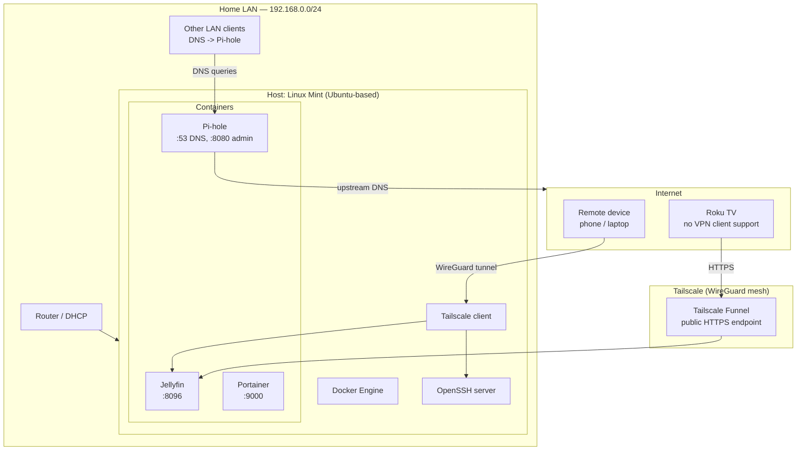

# Homelab: Self-Hosted Media Server & Network Services on Repurposed Hardware

A production-style homelab built from a retired Intel MacBook Pro,
running Linux Mint Server-mode and hosting a containerized media
server, network-wide ad-blocking DNS, and secure remote access —
with no cloud spend and no purchased hardware.

## Overview

This project repurposes decommissioned consumer hardware into a
self-managed Linux server, demonstrating end-to-end systems
administration: OS deployment, container orchestration, DNS/network
services, and secure remote access, all documented with the actual
issues encountered and how each was diagnosed and resolved.

## Architecture



## Tech Stack

| Layer | Technology | Purpose |
|---|---|---|
| OS | Linux Mint (Ubuntu 24.04 base) | Host operating system |
| Containerization | Docker Engine, Docker CLI | Service isolation and deployment |
| Container management | Portainer CE | Visual container/stack administration |
| Media server | Jellyfin | Self-hosted streaming, no third-party account required |
| DNS / ad-blocking | Pi-hole | Recursive DNS filtering at the network level |
| Remote access | Tailscale (WireGuard) | Zero-config mesh VPN, no port forwarding |
| Public exposure | Tailscale Funnel | HTTPS ingress for clients that can't run a VPN client (e.g. smart TVs) |
| General-purpose VPN | ProtonVPN | Outbound privacy VPN on the host itself |
| Remote administration | OpenSSH, Termius (iOS) | Encrypted shell access from any network |

## Repository Structure

```
.
├── README.md
└── docs/
    ├── 01-architecture.md
    ├── 02-installation.md
    ├── 03-containerization.md
    ├── 04-media-server.md
    ├── 05-networking-dns.md
    ├── 06-remote-access-security.md
    └── 07-challenges-and-resolutions.md
```

## Skills Demonstrated

- **Linux system administration**: OS installation, disk partitioning,
  user/group management, `systemd` service configuration
- **Containerization**: Docker image deployment, volume/bind-mount
  design, container networking, troubleshooting failed deployments
- **Networking & DNS**: static IP reservation, DNS resolution chains,
  `/etc/resolv.conf` and `systemd-resolved` internals, diagnosing
  port conflicts, DNS-based ad filtering
- **Security & remote access**: SSH hardening basics, VPN tunneling
  (WireGuard via Tailscale), least-exposure public ingress (Funnel
  instead of full port forwarding)
- **Systematic troubleshooting**: root-cause diagnosis across the
  network stack (see `docs/07-challenges-and-resolutions.md`) —
  package repository mismatches, DNS listening-mode restrictions,
  and DNS resolver conflicts between two services managing the same
  config file

## Notes on Security

Sensitive values (the actual static IP, Pi-hole admin credentials,
Tailscale tailnet name, and the Funnel URL) are represented as
placeholders throughout this documentation and are not committed to
this repository.

## License

MIT — see [LICENSE](LICENSE).
